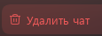
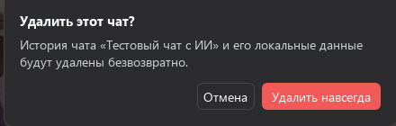
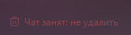
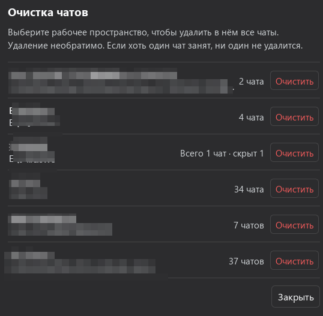
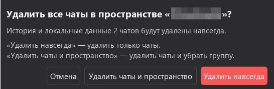
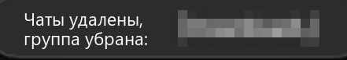

# Удаление чатов DSH

`dsh-session-clean-ru` — локальный русскоязычный форк [dsh-session-clean](https://github.com/Ansellwan/DeepSeekHarness-Session-Delete) автора [Ansellwan](https://github.com/Ansellwan). Он добавляет в DeepSeek Harness (DSH) удаление отдельного чата и пакетную очистку чатов рабочего пространства. **Удаление чатов необратимо: корзины и отмены нет. Файлы вложений не удаляются.**

## Удаление из меню чата

1. Откройте меню `⋯` нужного чата и выберите **Удалить чат**.
2. Проверьте, что выбран нужный чат, и нажмите **Удалить навсегда**.

Можно удалять и архивные чаты. Если чат занят (например, отвечает или ждёт подтверждения), действие недоступно. Перед удалением DSH повторно проверяет состояние чата. Если открытый чат нельзя безопасно выгрузить из памяти, форк сообщает об ошибке и не удаляет его данные; он не подменяет удаление скрытием в архиве.

Ниже — русифицированные иллюстрации на основе оригинальных демонстраций Ansellwan, а не снимки рабочего профиля DSH.

## Удаление через агента

Попросите агента: «Удали чат с точным названием „Черновик отчёта“». Инструмент `delete_chat_by_title` ищет одно точное совпадение с учётом регистра, показывает название и идентификатор чата в запросе на подтверждение и ждёт разового разрешения через штатный механизм DSH (`approval`). Сообщение в чате не заменяет это подтверждение.

Если совпадений нет или их несколько, не удалось проверить все заголовки, изменилось название выбранного чата или DSH не выдал разовое разрешение, удаления не будет. Если механизм подтверждения недоступен, инструмент не регистрируется. Нельзя удалить чат, из которого отправлен запрос; для этого откройте другой чат или воспользуйтесь меню.

## Пакетная очистка рабочего пространства

Нажмите **Очистить чаты** внизу боковой панели, выберите пространство или раздел **Без группы**, проверьте число чатов и подтвердите очистку. В число чатов входят архивные и другие чаты, не показанные в текущем списке. Если предварительная проверка находит занятый чат, очистка не начинается. Затем чаты удаляются по одному, с повторными проверками; возможен частичный результат.

| Действие | Что происходит |
|---|---|
| Штатное **Удалить рабочее пространство** | Пространство убирается из списка, чаты сохраняются в разделе **Без группы**. |
| **Очистить чаты** → **Удалить навсегда** | Плагин удаляет чаты и оставляет рабочее пространство в списке. |
| **Очистить чаты** → **Удалить чаты и пространство** | Плагин запускает удаление чатов, затем пытается убрать рабочее пространство из списка. Папка проекта не удаляется. |

## Что удаляется

- Журнал выбранного чата, запись в кэше `session_projcache` (например, заголовок, оглавление и статистика токенов), каталог больших выводов инструментов и ссылки на чат в реестре рабочих пространств, архива и закреплений.
- Не удаляются файлы вложений в `~/.dsh/attachments/`, журнал операций плагина `~/.dsh/logs/session-delete.log` и копии данных в хранилищах других плагинов.

### Вложения: только анализ ссылок

Форк ищет ссылки на изображения и файлы только в журнале удаляемого чата, а журналы других чатов читает, чтобы выявить общие вложения. Файлы вложений сохраняются независимо от результата проверки. В DSH `0.2.2-rc.3` такая проверка не видит вложения, загруженные, но ещё не отправленные в чат, и может не увидеть нечитаемые журналы.

Для будущего физического удаления можно рассматривать только вложения из удаляемого чата. Общие вложения должны оставаться; удалять файл допустимо лишь тогда, когда DSH может подтвердить, что ни один другой чат или незавершённая загрузка на него не ссылается. Отсутствия ссылок в доступных журналах для этого недостаточно. В текущем форке физическое удаление вложений не реализовано.

## Технические примечания

- `client.js` добавляет пункт в `sidebar.workspaces.session.menu.item` и показывает подтверждение через `shell.overlay`. Клиент обращается к маршруту `/_dsh-session-clean-ru` внутри DSH; хост проверяет доверие соединения штатным механизмом DSH. Форк не отправляет телеметрию и не обращается к внешним сервисам.
- `index.js` выгружает незанятый чат, если тот находится в памяти, затем исключает его из реестра и удаляет сохранённые данные. Для выгрузки используются внутренние методы `liveEntryFor` и `detachEntered`; форк не меняет `app.asar` и не заменяет штатные действия DSH.
- [Предложение по публичному API выгрузки и удаления чатов](<docs/Предложение по API выгрузки чатов.md>) — перевод исторического черновика исходного проекта, а не описание поддерживаемого API текущей версии DSH.

## Проверка и статус

Из каталога форка можно запустить `npm test`: тесты используют изолированные данные. Форк не установлен в рабочем профиле DSH. Инструкции по установке и сведения о совместимости оригинала не относятся к этому форку.

## Авторство и лицензия

© 2026 Ansellwan, автор [исходного проекта](https://github.com/Ansellwan/DeepSeekHarness-Session-Delete) и демонстрационных скриншотов. Форк сохраняет [лицензию MIT](LICENSE).
